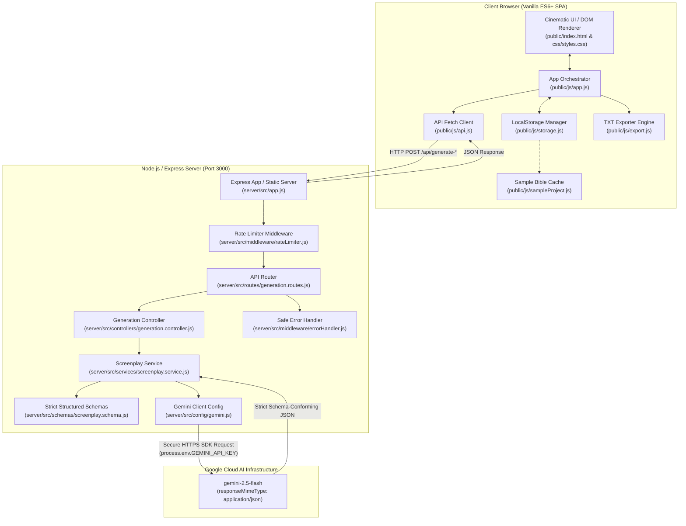

# 🎬 CineDirector AI — AI-Powered Screenplay Production Studio

> **Transform a one-line movie concept into an exhaustive, Hollywood-caliber screenplay and film-production bible.**

[](https://nodejs.org/)
[](https://expressjs.com/)
[](https://aistudio.google.com/)
[](LICENSE)

---

## 📖 Table of Contents

- [Overview & Product Vision](#-overview--product-vision)
- [What CineDirector AI Does](#-what-cinedirector-ai-does)
- [System Architecture](#-system-architecture)
  - [High-Level Architecture Diagram](#high-level-architecture-diagram)
  - [Component Breakdown](#component-breakdown)
  - [Data Flow Workflow](#data-flow-workflow)
- [Directory Structure](#-directory-structure)
- [API Reference & Specifications](#-api-reference--specifications)
- [Frontend UI/UX Design System](#-frontend-uiux-design-system)
- [AI Engineering & Security Safeguards](#-ai-engineering--security-safeguards)
- [Quick Start & Setup Guide](#-quick-start--setup-guide)
  - [Prerequisites](#prerequisites)
  - [Installation](#installation)
  - [Environment Configuration](#environment-configuration)
  - [Running the Application](#running-the-application)
- [Automated Testing](#-automated-testing)
- [Troubleshooting & FAQs](#-troubleshooting--faqs)
- [License](#-license)

---

## 🌟 Overview & Product Vision

**CineDirector AI** is a professional-grade web application and digital production studio designed specifically for independent filmmakers, screenwriters, cinematographers, and AI video creators. 

Unlike generic conversational AI chatbots that output disjointed text snippets, CineDirector AI operates as a **virtual film studio**. It accepts a high-concept premise (e.g., *"A young woman discovers that every dream she has predicts a real-world catastrophe exactly 24 hours before it happens"*) and processes it through an advanced directorial pipeline, returning an integrated **10-part production package**.

---

## 🚀 What CineDirector AI Does

From a single premise, CineDirector AI generates a complete production package conforming to strict industry formats:

| Production Artifact | Description |
| :--- | :--- |
| **Movie Metadata** | Title, logline, target runtime, primary language, tone, and the underlying moral theme. |
| **Three-Act Structure** | Rigorous narrative architecture: Act I (Inciting Incident & Turning Point), Act II (Rising Action, Midpoint & Dark Night of the Soul), and Act III (Climax & Resolution). |
| **Character Dossiers** | Psychological profiles, core motivations, subconscious desires, fatal flaws, character arcs, physical descriptions, and wardrobe/costume notes. |
| **Screenplay Script** | Industry-standard Hollywood formatting: scene sluglines (`INT. APARTMENT - DAWN`), atmospheric action blocks, centered uppercase character cues, parentheticals, and dialogue. |
| **Cinematographer Shot Lists** | Detailed camera setups: shot sizes (EWS, WS, MCU, ECU), camera movements (Steadicam orbit, dolly in, crane descent), focal lengths (e.g. 28mm Anamorphic, 85mm T1.5), framing, lighting ratios, and directorial notes. |
| **Midjourney Art Prompts** | Photorealistic concept art prompts with camera models, lighting keys, aspect ratios (`--ar 16:9 --style raw --v 6.1`), and negative prompts. |
| **Runway Video Prompts** | Motion-optimized prompts with camera direction instructions (pan, tilt, zoom, motion brush) and visual style notes. |
| **Spatial Sound Design** | Environmental room tones, diegetic foley checklists, musical score cues with tempos and instrumentation, and psychological subtext. |
| **Production Summary** | Directorial aesthetic statement, curated 5-color palette with interactive hex swatches, technical production hurdles, and key creative decisions. |
| **Client-Side TXT Export** | Instant 1-click export generating an industry-standard formatted screenplay script and production bible `.txt` file. |
| **LocalStorage Persistence** | Full project management: auto-save, load, rename, duplicate, search, and delete saved projects directly in the browser. |

---

## 🏗️ System Architecture

CineDirector AI is architected with a strict separation of concerns, featuring a responsive Vanilla JavaScript frontend, an Express.js orchestration server, and the official Google GenAI SDK.

### High-Level Architecture Diagram



### Component Breakdown

#### 1. Frontend Layer (`public/`)
- **Zero Frontend Frameworks**: Built entirely using HTML5, modern CSS3, and ES6+ modules. This guarantees ultra-fast page loads, zero build-step overhead, and total native DOM control.
- **`app.js`**: Application state machine managing view transitions (Dashboard, Studio, My Projects, Settings), tab selections, inline editing, sub-generation triggers, and modal dialogs.
- **`api.js`**: Lightweight fetch abstraction communicating with the backend, complete with health checks and error parsing.
- **`storage.js`**: Manages browser `localStorage` under `cinedirector_projects_v1`. Supports project CRUD, duplication, active project tracking, and JSON backups.
- **`export.js`**: Converts internal JSON structures into an industry-standard screenplay script with indented dialogue, sluglines, and production notes, downloading as a `.txt` file.
- **`sampleProject.js`**: Contains a rich, complete production bible (*"Dream Echoes"*) pre-loaded so users can test the application immediately without an API key.

#### 2. Backend Orchestration Layer (`server/src/`)
- **`app.js`**: Initializes Express, configures CORS, sets a 10MB JSON request body limit, serves static assets from `public/`, and routes API requests.
- **`routes/generation.routes.js`**: Defines the endpoints, shielded by sliding-window rate limiters.
- **`controllers/generation.controller.js`**: Validates incoming request parameters (premise lengths, runtimes, array boundaries) and passes requests to the service layer.
- **`middleware/rateLimiter.js`**: In-memory token bucket/sliding window rate limiter protecting endpoints against accidental spam and DoS.
- **`middleware/errorHandler.js`**: Intercepts model errors (quota limits, invalid keys, safety filters) and translates them into safe, friendly client responses without leaking stack traces or credentials.

#### 3. AI Service & Schema Layer
- **`config/gemini.js`**: Manages singleton client initialization for `@google/genai` and reads `process.env.GEMINI_API_KEY`.
- **`schemas/screenplay.schema.js`**: Uses `@google/genai` `Type` enums (`Type.OBJECT`, `Type.ARRAY`, `Type.STRING`, `Type.INTEGER`) to define strict schema contracts for:
  - `fullScreenplaySchema` (The entire film package)
  - `scenesArraySchema` (Modular scene expansion)
  - `shotListsArraySchema` (Camera breakdowns)
  - `promptsPackageSchema` (Midjourney & Runway prompts)
  - `audioDesignArraySchema` (Sound cues)
- **`services/screenplay.service.js`**: Constructs multi-persona directorial prompts (Screenwriter, Cinematographer, Art Director, Sound Designer) and executes Gemini calls with `responseMimeType: 'application/json'`.

### Data Flow Workflow

1. **User Input**: The user inputs a movie premise on the Dashboard and configures Genre, Tone, Runtime, Language, and Audience.
2. **Validation**: Client validates input (min 10 characters) and displays a multi-stage cinematic progress modal.
3. **Backend Intake**: Express receives `POST /api/generate-screenplay`, enforces rate limits, and validates payload sizes.
4. **AI Generation**: Gemini 2.5 Flash processes the prompt through the structured JSON schema.
5. **Sanitization & Parsing**: Server strips any markdown fences, validates schema keys, and returns clean JSON.
6. **Local Persistence**: Client saves the result to `localStorage` and automatically navigates to the **Screenplay Studio**.
7. **Interactive Studio**: User explores tabs, makes inline edits, copies individual prompts, triggers sub-generation, or exports to TXT.

---

## 📁 Directory Structure

```text
CineDirector/
├── server/
│   ├── src/
│   │   ├── config/
│   │   │   └── gemini.js            # Official @google/genai configuration
│   │   ├── controllers/
│   │   │   └── generation.controller.js # Input validation & controller logic
│   │   ├── middleware/
│   │   │   ├── errorHandler.js      # Centralized error mapping & sanitization
│   │   │   └── rateLimiter.js       # In-memory sliding-window rate limiter
│   │   ├── routes/
│   │   │   └── generation.routes.js # Router mounting health and generation routes
│   │   ├── schemas/
│   │   │   └── screenplay.schema.js # Strict structured JSON schemas with Type enums
│   │   ├── services/
│   │   │   └── screenplay.service.js# Directorial prompt architecture & SDK calls
│   │   └── app.js                   # Express application setup and static file server
│   └── test/
│       ├── health.test.js           # Server health & route tests
│       ├── schemas.test.js          # Schema definitions integrity tests
│       ├── validation.test.js       # Input validation tests
│       ├── errors_and_ratelimit.test.js # Rate limiter & error handling tests
│       └── subschemas_and_endpoints.test.js # Sub-schemas & 503 key checks
├── public/
│   ├── index.html                   # Production Studio HTML5 single-page application
│   ├── css/
│   │   └── styles.css               # Cinema dark mode, gold accents & responsive layout
│   └── js/
│       ├── api.js                   # Frontend fetch client & error handling
│       ├── app.js                   # Application state machine, tabs & DOM renderer
│       ├── export.js                # Industry-standard screenplay TXT export engine
│       ├── sampleProject.js         # Pre-configured "Dream Echoes" production bible
│       └── storage.js               # Browser LocalStorage CRUD management
├── .env.example                     # Environment configuration template
├── .gitignore                       # Git ignore file (secures .env and node_modules)
├── package.json                     # NPM dependencies, ES module setup & test scripts
└── README.md                        # Documentation
```

---

## 📡 API Reference & Specifications

### 1. Health Status
- **`GET /api/health`**
- **Response**:
```json
{
  "success": true,
  "status": "healthy",
  "service": "CineDirector AI Engine",
  "version": "1.0.0",
  "geminiConfigured": true,
  "model": "gemini-2.5-flash",
  "timestamp": "2026-10-11T09:55:00.000Z"
}
```

---

### 2. Generate Screenplay Production Bible
- **`POST /api/generate-screenplay`**
- **Rate Limit**: 30 requests / minute / IP
- **Request Body**:
```json
{
  "idea": "A detective can hear the memories of abandoned objects in a flooded dystopian city.",
  "genre": "Neo-Noir / Cyberpunk",
  "tone": "Atmospheric, Rain-Drenched & Melancholic",
  "runtimeMinutes": 110,
  "language": "English",
  "targetAudience": "General Cinema Audience",
  "creativeConstraints": "35mm anamorphic aesthetic, practical effects, avoid cheap tropes."
}
```
- **Response**: Returns the complete production bible conforming to `fullScreenplaySchema`.

---

### 3. Generate or Expand Scenes
- **`POST /api/generate-scenes`**
- **Request Body**:
```json
{
  "projectTitle": "The Memory Detective",
  "logline": "A detective reads psychic residue of lost items.",
  "genre": "Neo-Noir",
  "tone": "Atmospheric",
  "characters": [...],
  "existingScenes": [...],
  "sceneRequest": "Write Act 2 midpoint confrontation at the flooded docks"
}
```

---

### 4. Generate Director's Shot List
- **`POST /api/generate-shotlist`**
- **Request Body**:
```json
{
  "projectTitle": "The Memory Detective",
  "genre": "Neo-Noir",
  "tone": "Atmospheric",
  "scenes": [...]
}
```

---

### 5. Generate AI Visual Prompts
- **`POST /api/generate-prompts`**
- **Request Body**:
```json
{
  "projectTitle": "The Memory Detective",
  "genre": "Neo-Noir",
  "tone": "Atmospheric",
  "visualStyle": "35mm high-contrast chiaroscuro with neon reflections",
  "scenes": [...],
  "characters": [...]
}
```

---

### 6. Generate Audio Design & Soundscapes
- **`POST /api/generate-audio-design`**
- **Request Body**:
```json
{
  "projectTitle": "The Memory Detective",
  "genre": "Neo-Noir",
  "tone": "Atmospheric",
  "scenes": [...]
}
```

---

## 🎨 Frontend UI/UX Design System

CineDirector AI features an auteur cinema visual design system:

- **Signature Palette: Cherry & Matcha**:
  - **Cherry (`#670626`)**: Deep velvet cherry wine used for key backgrounds, emblems, badges, cards, and dramatic cinematic lighting.
  - **Matcha (`#BAD797`)**: Soft pistachio matcha green for luminescence, active tabs, buttons, borders, highlights, and sluglines.
  - **Deep Canvas (`#0E0308`)**: Nocturnal cherry-noir void background.
  - **Secondary Surface (`#170610`)**: Deep cherry obsidian.
  - **Card Glass (`rgba(28, 9, 19, 0.82)`)**: Translucent frosted panels with `backdrop-filter: blur(12px)`.
  - **Borders & Accents**: `rgba(186, 215, 151, 0.24)` (Matcha sheen) & `rgba(103, 6, 38, 0.55)` (Cherry rim).
- **Typography**:
  - Headings & Titles: `'Cinzel'` / `'Outfit'` (Cinematic Serif / Display)
  - Body & Controls: `'Plus Jakarta Sans'` / `'Inter'` (Clean Sans-Serif)
  - Screenplay Scripts & Prompts: `'Courier Prime'` / `'JetBrains Mono'` (Monospace)
- **Responsive Layout**:
  - Desktop sidebar with collapse/expand toggle.
  - Mobile slide-out drawer with backdrop blur.
  - Fluid grids adapting from 4K displays down to mobile smartphones.

---

## 🔒 AI Engineering & Security Safeguards

1. **Key Confinement**: The `GEMINI_API_KEY` is loaded strictly on the backend using `process.env`. It is never returned in network responses, logged in console outputs, or exposed to browser scripts.
2. **Safe DOM Rendering**: All AI-generated content (dialogue, descriptions, prompts) is rendered safely using native DOM properties (`textContent`, document fragments, and attribute setting) to eliminate Cross-Site Scripting (XSS).
3. **Structured Schemas**: All responses use Gemini's `responseSchema` to guarantee strict JSON formatting and prevent hallucinations or malformed text blocks.
4. **Sliding-Window Rate Limiting**: Built-in in-memory rate limiting prevents API abuse and denial-of-service spikes.
5. **Payload Bounds**: Max input length of 2000 characters for premises and a 10MB Express body limit.

---

## ⚡ Quick Start & Setup Guide

### Prerequisites
- **Node.js**: v18.0.0 or higher (v22+ recommended).
- **npm**: v9.0.0 or higher.
- *(Optional)*: A free Google Gemini API key from [Google AI Studio](https://aistudio.google.com/).

### Installation

1. Clone or open the project directory:
   ```bash
   cd CineDirector
   ```
2. Install dependencies:
   ```bash
   npm install
   ```

### Environment Configuration

1. Create a `.env` file from the provided `.env.example`:
   ```bash
   cp .env.example .env
   ```
2. Open `.env` and configure your settings:
   ```env
   # Server Port
   PORT=3000

   # Google Gemini API Key
   GEMINI_API_KEY=your_actual_gemini_api_key_here

   # Model Selection
   GEMINI_MODEL=gemini-2.5-flash

   # Environment
   NODE_ENV=development
   ```

> **Instant Demo Mode**: If you do not have an API key yet, CineDirector AI will still run! You can launch the app and click **"✨ Load Sample Bible"** on the top navigation bar to explore the complete studio workspace (*Dream Echoes*), edit scenes, view shot lists, copy prompts, and export TXT scripts.

### Running the Application

- **Production Mode**:
  ```bash
  npm start
  ```
- **Development Mode (Auto-Reload)**:
  ```bash
  npm run dev
  ```
- Open your browser at:
  ```text
  http://localhost:3000
  ```

---

## 🧪 Automated Testing

The project includes an automated test suite utilizing Node.js's native test runner (`node:test`) and strict assertions (`node:assert/strict`):

```bash
npm test
```

### Test Coverage Summary:
- **`health.test.js`**: Validates `GET /api/health` configuration reporting and route 404 handling.
- **`validation.test.js`**: Tests edge cases for premise lengths, missing fields, invalid runtimes, and empty scene arrays.
- **`schemas.test.js`**: Confirms that root properties and sub-schemas conform to the required JSON schema structure.
- **`errors_and_ratelimit.test.js`**: Tests sliding-window rate limit throttling (429 status) and safe error mapping for invalid keys, quotas, and safety triggers without leaking credentials.
- **`subschemas_and_endpoints.test.js`**: Verifies sub-schemas and ensures missing API keys return clear 503 error codes.

---

## ❓ Troubleshooting & FAQs

### 1. `⚠️ GEMINI_API_KEY missing - configure in .env file`
- **Cause**: The `.env` file does not contain a valid `GEMINI_API_KEY`.
- **Solution**: Obtain a free API key at [aistudio.google.com](https://aistudio.google.com/) and paste it into `.env`. Restart the server with `npm start`.

### 2. `RESOURCE_EXHAUSTED / Rate Limit Exceeded`
- **Cause**: Google Gemini free-tier quota limits were reached.
- **Solution**: Wait 60 seconds before making another request. The backend error handler maps this cleanly and returns HTTP 429.

### 3. Port 3000 is already in use
- **Solution**: Change `PORT=3001` in your `.env` file and restart.

---

## 📄 License

This project is licensed under the **MIT License**. Built for independent filmmakers, screenwriters, and AI creators.
